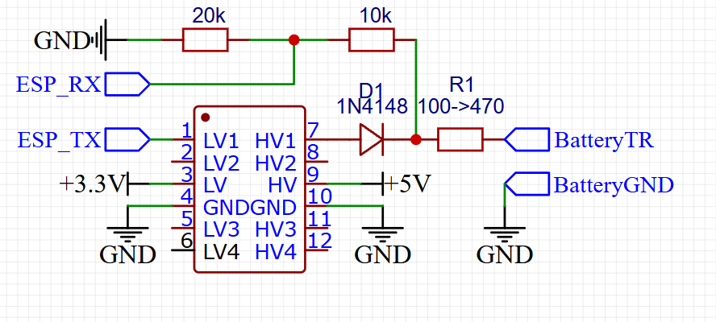
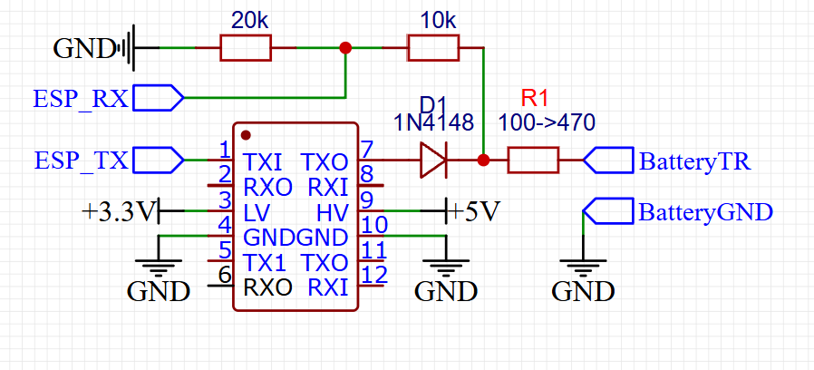
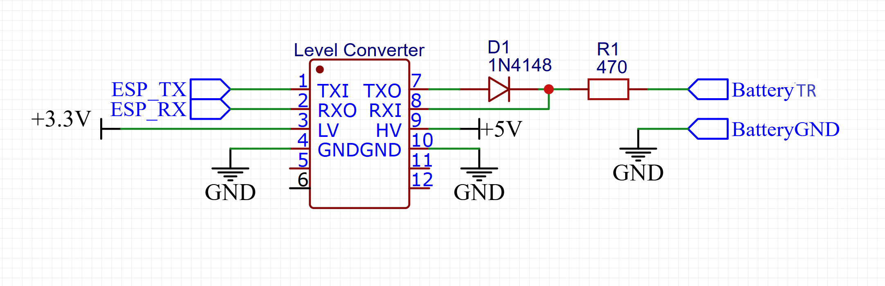
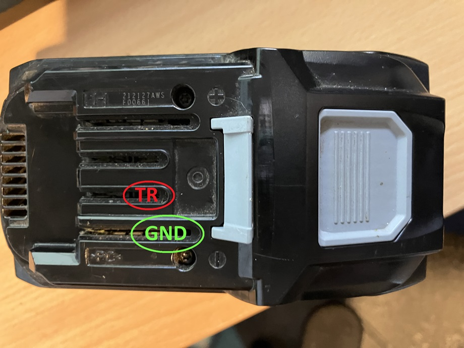

# Makita XGT Battery Tester

Basic tester for Makita's line of 40V XGT batteries which retrieves the following information:

  

 - Model
   
  - Charge Count
   
  - Health
   
  - Charge
   
   - both temperature sensors
  
   - lock status
   
  - Pack Voltage
   
  - Individual Cell Voltages

Can be used to create your own basic tester or as a template for a project of your own, whilst my basic example reports received data via serial it should be easy enough to send this data via bluetooth, show on an LCD display, show on a web page whatever.

WARNING – Build this at your own risk, if assembled incorrectly this may start a fire, damage your micro controller or brick your expensive XGT battery. I take less than 0 responsibility if any of this happens.

I am not a programmer nor am I an electronics engineer, I slapped this together as an academic exercise more than anything else and it is not intended as a turn key project. You should not build this unless you have an understanding of electronics, programming and the risks involved.

## Hardware:
For my example I chose an ESP32-C3, namely because I already had one but also because the ESP32-C3 has 2 hardware uart interfaces and the ability to operate in inverted mode which is a requirement to communicate with these batteries. As well as this the ESP32-C3 also has Bluetooth and WiFi giving multiple options to present the data.

Any of the below example circuits should be suitable to interface with the battery. These batteries operate on 5V logic and the ESP32 3.3v so the logic level converter is a must. 

Note I have found level converters vary in quality and component values used may differ between brands, option 1 and 2 are the most likely to work, option 3 may work but it will depend on how the specific level shifter is constructed. R1 can be anywhere from 100 - 470 ohms it simply exists to limit current from the battery and prevent damage in event of a wiring issue, you can even leave it out if need be. 

#### Option 1 - bidirectional level shifter used for TX, resistive divider used for RX.

#### Option 2 - unidirectional level shifter used for TX, resistive divider used for RX.

#### Option 3 - unidirectional level shifter used alone.

The circuit should be connected to your chosen tx / rx pins and the GND / TR pins on the battery as per the picture below:

## Software:

Software is based on existing work by “Malvineous” and data I captured from a genuine Makita battery tester, more info here:

https://github.com/Malvineous/makita-xgt-serial

[https://sites.google.com/view/xgtdata/home](https://sites.google.com/view/xgtdata/home)

 Assuming you are using an ESP32-C3 to get started edit lines 3, 4 and 5 to match your specific hardware configuration, with nothing connected when the button is pressed you should see the message “"Error Communicating With Battery" printed on the serial console. Once the battery is connected you should see an output similar to the example below. Good luck.

 Model BL4025  

Charge Count 1

Health 90%

Charge 99%

Temperature 19.5

Pack Voltage 41.1 v

Cell 1 - 4.1 v

Cell 2 - 4.1 v

Cell 3 - 4.1 v

Cell 4 - 4.1 v

Cell 5 - 4.1 v

Cell 6 - 4.1 v

Cell 7 - 4.1 v

Cell 8 - 4.1 v

Cell 9 - 4.1 v

## Reset:

Pressing and holding the button for more than 5 seconds before releasing will attempt to command the battery to do a factory reset which may allow it to recover from certain faults.
 
Only do this if really necessary and as an absolute last resort, do not do it just for fun as it will likely brick your battery. If you have a battery that has stopped charging or has developed some other issue this has usually happened for a reason. 

The reset command will reset all data including charge counts etc and may result in the BMS being irreparably damaged, you have been warned. 

Thanks to https://github.com/no-body-in-particular/m5din-makita-xgt
